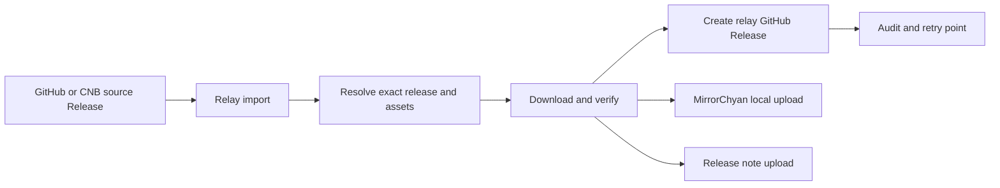

# Release relay architecture

## Scope

The relay is a GitHub based distribution adapter for products whose engineering
releases may live in GitHub or CNB. It is not a source repository and it does not
replace the source release as the engineering record.

The relay owns four things:

1. selecting an exact source release;
2. validating and staging the exact assets;
3. publishing a namespaced relay Release for audit and recovery;
4. sending the staged files and release note to MirrorChyan.

The source version is preserved separately from the internal relay tag. MirrorChyan
receives the source version, never the relay's internal tag.

## Target flow



The first implementation uses `workflow_dispatch`. Later, a source repository or a
scheduled relay job can send a `release-ready` event after the source assets are
complete. The event must contain an exact tag or release ID; the relay must never
guess from a moving `latest` pointer during a publish operation.

## Release identity

Every imported release has two identities:

```text
source:
  repository: AlkaidLab/foundation-sunshine
  tag: v2026.1020.23431.杂鱼
  release_id: 417992401

relay:
  tag: relay/foundation-sunshine/v2026.1020.23431-417992401
```

The source identity is used for the user-facing version, MirrorChyan version, and
release notes. The relay identity is only used to avoid collisions between products
and to make a rerun idempotent.

## Product configuration

`config/products.yml` describes only products whose MirrorChyan resource ID and
platform mapping were supplied by MirrorChyan. Each asset rule must select exactly
one file from the source release. A product may have multiple rules when it has
multiple independent resource streams.

The configuration will eventually contain:

```yaml
products:
  example:
    source:
      kind: github # github or cnb
      repository: owner/repository
    mirror:
      resource_id: supplied-by-mirrorchyan
    assets:
      - id: windows-installer
        source_pattern: 'Example.*Installer.exe'
        os: win
        arch: x64
        resource_type: exec
```

Do not put a guessed RID in this file. Separate independently updated components
should use separate official resource IDs.

## Import job phases

The production workflow should run as one idempotent job for one product and one
source release:

1. Resolve the source release by exact tag or release ID.
2. Reject drafts and incomplete asset matches.
3. Download each selected asset into the runner workspace.
4. Verify size, SHA256, and any project signature/checksum file available from the
   source release.
5. Create or update the namespaced relay Release and upload the same bytes.
6. Verify the relay Release asset names and sizes.
7. Upload the local staged files to MirrorChyan with the original source version and
   explicit channel/platform/architecture.
8. Send the source release note explicitly to MirrorChyan.
9. Publish a `relay-manifest.json` containing source identity, asset hashes, relay
   release URL, and Mirror upload results.

The job uses a concurrency key based on product and source release ID. A retry must
reuse the same key and relay tag rather than create a second logical release.

## Storage choices

The relay must not commit binary files into Git. The source bytes live temporarily in
the import runner, then in GitHub Release assets and MirrorChyan's storage. Actions
artifacts are not part of the durable design; the test organization currently has a
full free artifact quota.

## Secrets and permissions

The relay will eventually hold:

- `MirrorChyanUploadToken` for the relay repository only;
- a CNB token only if the selected CNB releases are not public;
- a GitHub App or narrowly scoped token only if automatic cross-repository dispatch is
  enabled.

The production workflow should use `contents: write` only for the job that creates
relay Releases. A dry-run needs `contents: read` only. No source repository needs the
MirrorChyan token.

## Rollout

1. Foundation Sunshine GitHub source, dry-run only — implemented.
2. Foundation Sunshine download, hash, relay Release, and Mirror upload.
3. CNB source adapter using the actual CNB release API and asset URLs.
4. Add one client with an official MirrorChyan RID and explicit platform mapping.
5. Add remaining clients and components as separate product/resource streams.
6. Add automatic release-ready dispatch or scheduled reconciliation after the manual
   path has been proven.
