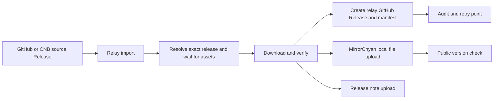

# Release relay architecture

## Scope

The relay is a GitHub based distribution adapter for products whose engineering
releases may live in GitHub or CNB. It is not a source repository and it does not
replace the source release as the engineering record.

The relay owns four things:

1. selecting an exact source release;
2. validating and staging the exact assets;
3. publishing a namespaced relay Release for audit and recovery;
4. sending the staged file and release note to MirrorChyan.

The source version is preserved separately from the internal relay tag. MirrorChyan
receives the source version, never the relay's internal tag.

## Flow



Two triggers exist today: an exact `workflow_dispatch` and a reconciliation
schedule every 15 minutes. Both call the same planner and the same per-release
job. A source repository never receives a workflow or a secret.

The planner never guesses from a moving `latest` pointer. A dispatch with a tag
resolves that tag to an immutable release id; the schedule compares source
releases with the relay Releases that already exist.

## Release identity

Every imported release has two identities:

```text
source:
  repository: AlkaidLab/foundation-sunshine
  tag: v2026.1031.121458.杂鱼
  release_id: 429927943

relay:
  tag: relay/foundation-sunshine/v2026.1031.121458-429927943
```

The source identity is used for the user-facing version, MirrorChyan version and
release note. The relay tag keeps only ASCII letters, digits, `.`, `_` and `-`,
and ends with the source release id so it can be parsed back without reading an
asset. Collisions between products are impossible; the release id makes reruns
of the same source release address the same relay Release.

## Product configuration

`config/products.yml` describes only products whose MirrorChyan resource ID and
platform mapping were supplied by MirrorChyan. Each product is one resource
stream and has exactly one asset rule; a product with independent components gets
another product key and its own official resource ID.

The rule carries both names used by the two APIs: `os` / `arch` for the upload
action (`win`, `x64`) and `query_os` / `query_arch` for the public version check
(`windows`, `amd64`).

```yaml
products:
  example:
    source:
      kind: github
      repository: owner/repository
      public: true
    mirror:
      resource_id: supplied-by-mirrorchyan
    assets:
      - id: windows-installer
        source_pattern: 'Example.*Installer.exe'
        os: win
        arch: x64
        query_os: windows
        query_arch: amd64
        resource_type: exec
```

Do not put a guessed resource ID in this file. The relay refuses products that
are not configured.

## State and idempotence

The relay Release is the only durable state. Its `relay-manifest.json` asset
records:

- source repository, release id, tag, publication time, pre-release flag and a
  SHA256 of the release body;
- the asset rule, source asset id, name, size, SHA256 and the checksum files that
  agreed;
- the relay tag and creation time;
- MirrorChyan resource, version name, os, arch, and an `uploads` map keyed by
  channel (`stable`, `beta`), each with `started`, `uploaded` or `failed`;
- a note `uploads` map keyed by channel, each with `synced`, `failed` or `empty`
  and the body hash that was sent.

There is no committed state file and no Actions artifact dependency. Listing
relay Releases plus reading their small manifests is enough to plan the next run.

The upload is guarded by the manifest, not by retry heuristics:

- No relay Release: download, verify, create, upload.
- Manifest has an `uploaded` record for the current channel: never upload this
  source release and asset to that channel again.
- Manifest has a `beta` upload but no `stable` upload and the source is now a
  normal release: upload once to `stable` (promotion) and sync the stable note.
- Manifest has a `stable` upload but no `beta` upload and the source is now a
  pre-release: log the demotion and do not upload.
- The source tag is older than or equal to the channel's reported latest: log
  `skip upload` and do not upload. A tag that does not match
  `v<year>.<mmdd>.<hhmmss>[.<suffix>]` is refused.
- Manifest `started` or `failed`: flag the release for manual review rather than
  risk a second upload. The operator deletes the relay Release only after
  confirming with MirrorChyan that the version is absent.
- Source asset id or size differs from the manifest: flag the release; the bytes
  changed under the same source release.

The plan job is also the place where body edits and promotions are detected. It
compares the manifest's note hash for the current channel with the source body;
an edit produces a note-only entry. It compares the source `prerelease` flag with
the recorded channel uploads; a pre-release that became normal produces one
stable upload entry.

## Import job phases

The workflow runs one idempotent job per product and source release:

1. Resolve the source release by exact id, reject drafts.
2. Wait until exactly one asset matches the rule and its state is `uploaded`
   (40 attempts, 15 seconds apart by default).
3. Download into the runner workspace and verify the declared size and SHA256.
4. Cross-check every configured checksum file present in the release. A present
   file without an entry for the asset is an error.
5. Create the namespaced relay Release and upload the same bytes plus the
   manifest, or reuse the existing one when the recorded bytes match.
6. Compare the source tag with the version MirrorChyan reports for the target
   channel; skip an equal or older tag and refuse an unparsable one.
7. Upload the verified local file through MirrorChyan's documented version API:
   create the version, store the object, call back, then poll the processing
   status. The source tag is the version name and the channel is explicit.
8. Confirm the version through the public MirrorChyan API. The version check is
   also what distinguishes a real upload from an artifact-upload failure inside
   the vendor action.
9. Send the source release body to the release-note action, then record the
   outcome in the manifest.

The workflow concurrency group serialises runs, and the job matrix is processed
one entry at a time in ascending release id order.

The vendor `uploading-action@v1` is not used for the package: its uploader puts
the raw version into a `Content-Disposition` header, and `http.client` on a Linux
runner cannot encode a non-Latin-1 tag. The relay sends the same fields with an
RFC 6266/5987 header and keeps TLS verification enabled. The release-note action
is still used because its payload is JSON.

## Bootstrap and reconciliation

When no relay Release exists for a product, the planner imports the newest
stable release and the newest pre-release only. Replaying the whole history
would upload versions that MirrorChyan already serves, in arbitrary order. With
the current Foundation Sunshine releases that is `v2026.1031.121458.杂鱼`
(stable) and `v2026.1102.182113.杂鱼` (beta); `v2026.1020.23431.杂鱼` is already
served by MirrorChyan and is not imported.

After bootstrap, a release is new when its id is greater than the newest relay
release or when it was published later than the newest known release. The second
rule catches a draft that was held and published late with an older id. Older
unprocessed releases are never replayed.

## Secrets and permissions

- `MirrorChyanUploadToken` lives in this repository only. No source repository
  needs it.
- `contents: write` is needed only for relay Releases and their assets; the plan
  job needs reads.
- `issues: write` lets the vendor actions report a failure as an issue in this
  repository.
- `actions: write` is used to delete the small transient artifact the note action
  creates. The relay does not depend on it.
- A source repository that is not public would need `RELAY_SOURCE_TOKEN`; public
  sources are read without crossing a token boundary.

## Storage choices

The relay does not commit binary files into Git. Source bytes live temporarily in
the import runner, then in relay Release assets and MirrorChyan storage. The
manifest is small JSON and is replaced when an outcome changes. No Actions
artifact is used for the package, so package size does not consume artifact
quota.

## Rollout

1. Foundation Sunshine GitHub source, validation only - implemented.
2. Download, hash, relay Release, Mirror upload and note sync - implemented.
3. Scheduled reconciliation with an explicit live switch - implemented.
4. CNB source adapter using the actual CNB release API and asset URLs.
5. Further products and resource streams as MirrorChyan supplies them.

## Sources

Read on 2026-11-03 against the versions below:

- MirrorChyan integration guide, `MirrorChyan/docs` at `main`:
  `README.md`, `Integration.md`, `QuickStart.md`. Sections: automated upload,
  API parameters, channels, release notes.
- `MirrorChyan/uploading-action` at `v1` (`action.yml`, `python/upload.py`,
  commit `cca679d5`): version create, object upload, callback and status polling.
- `MirrorChyan/release-note-action` at `v1` (`action.yml`, `python/upload.py`,
  `PUT /api/resources/{rid}/versions/release-note`).
- GitHub REST API, releases endpoints (`create a release`, `upload a release
  asset`, `get a release by tag`, `list releases`), API version `2022-11-28`.
- GitHub Actions workflow syntax: `schedule`, `workflow_dispatch`, job outputs,
  matrix, `concurrency`, `permissions`.
- RFC 6266 and RFC 5987: `Content-Disposition` and the `filename*` parameter for
  non-ASCII file names.
- The source integration PR #1197 on `AlkaidLab/foundation-sunshine`: asset-wait
  loop, channel derivation and upload parameters.
